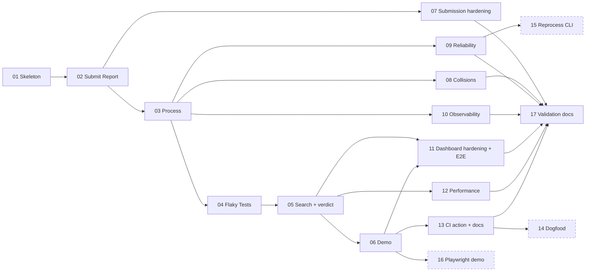

# Iteration 1: ticket plan

Source: [spec](spec.md), [SRS v1.1](../../docs/02-srs.md), [design](../../docs/03-design.md). Each ticket is one tracer-bullet slice (DB → API → UI → tests) sized for one focused implementation session.

## Order and blocking edges

| # | Ticket | Priority | Blocked by | Milestone |
|---|---|---|---|---|
| 01 | [Walking skeleton](issues/01-walking-skeleton.md) | must | none | System runs |
| 02 | [Operator creates a Project; CI submits a Report; the Reports page shows it](issues/02-create-project-and-submit-report.md) | must | 01 | Data arrives |
| 03 | [Worker processes Reports into Tests and Outcomes](issues/03-process-reports-into-outcomes.md) | must | 02 | Data is understood |
| 04 | [Flaky Tests list](issues/04-flaky-tests-list.md) | must | 03 | **Core loop visible** |
| 05 | [Test search and Test detail with verdict](issues/05-test-search-and-detail.md) | must | 04 | **Core loop complete** |
| 06 | [Reviewer demo: genuinely flaky suite and `npm run demo`](issues/06-reviewer-demo.md) | must | 05 | **Reviewer path works** |
| 07 | [Submission hardening](issues/07-submission-hardening.md) | must | 02 | Hardening |
| 08 | [Collision detection and warning](issues/08-collision-detection.md) | must | 03 | Hardening |
| 09 | [Processing reliability](issues/09-processing-reliability.md) | must | 03 | Hardening |
| 10 | [Observability](issues/10-observability.md) | must | 03 | Hardening |
| 11 | [Dashboard hardening and full core-workflow E2E](issues/11-dashboard-hardening-and-core-e2e.md) | must | 05, 06 | Quality |
| 12 | [Performance verification](issues/12-performance-verification.md) | must | 05 | Quality |
| 13 | [CI integration: composite action and setup docs](issues/13-ci-integration-action-and-docs.md) | must | 06 | Integration |
| 14 | [Dogfood workflow](issues/14-dogfood-workflow.md) | stretch | 13 | Integration |
| 15 | [Reprocess a Report from the CLI](issues/15-reprocess-report-cli.md) | stretch | 09 | Operations |
| 16 | [Playwright demo fixtures](issues/16-playwright-demo-fixtures.md) | stretch | 06 | Demo |
| 17 | [Validation and retrospective docs](issues/17-validation-and-retrospective-docs.md) | must | 01–13 (14–16 if done) | Close |

### Post-validation fixes (from `docs/04-validation.md`)

| # | Ticket | Priority | Blocked by | Fixes |
|---|---|---|---|---|
| 18 | [Stabilise the flaky Reports page E2E test](issues/18-stabilise-reports-e2e.md) | must | 17 | D-09 (AC-26) |
| 19 | [Dashboard gaps: Test detail counts; Reports page Collision text and stale errors](issues/19-dashboard-gaps-test-detail-and-reports.md) | must | 17 | D-01, D-02 (FR-29, FR-30) |
| 20 | [Security and validation fixes](issues/20-security-and-validation-fixes.md) | must | 17 | D-03, D-04, D-05, D-06, D-08 |
| 21 | [Complete state-change logging and worker resilience](issues/21-state-change-logging-and-worker-resilience.md) | stretch | 17 | D-07, D-10 |

18–21 don't depend on each other. Standards debt D-11 … D-14 stays recorded in the validation report and is not scheduled.

Suggested sequence: 01 → 02 → 03 → 04 → 05 → 06, then 07–13 in any order (they're independent of each other), stretch tickets if time allows, then 17. If time runs out after 13, the Must set is a complete, demoable product.

## Coverage check

Checked by script against `docs/02-srs.md`: every FR (Must, Should, Could), every NFR and every AC from AC-01 to AC-39 is covered by at least one ticket. **No gaps.**

| Requirement | Ticket(s) | | Requirement | Ticket(s) |
|---|---|---|---|---|
| FR-01 … FR-04 | 02 | | NFR-01 … NFR-03 | 12 |
| FR-05 … FR-08, FR-11 | 02 | | NFR-04, NFR-05 | 09 |
| FR-09, FR-10, FR-12 | 07 | | NFR-06 | 02, 10 |
| FR-13 … FR-16 | 03 | | NFR-07 | 07 |
| FR-17 | 08 | | NFR-08, NFR-09 | 11 |
| FR-18, FR-19 | 09 | | NFR-10 | 10 |
| FR-20 (C) | 15 | | NFR-11 | 01, 10 |
| FR-21 … FR-23, FR-27 | 04 | | NFR-12 | 01, 03 |
| FR-24, FR-25, FR-28, FR-29 | 05 | | NFR-13 | 06 |
| FR-26, FR-30 | 02 | | NFR-14 | 05, 11 |
| FR-31, FR-32 | 06 | | | |
| FR-33 | 13 | | | |
| FR-34 (S) | 14 | | | |
| FR-35 (C) | 16 | | | |

Shared ACs: AC-20 (list part in 04, verdict part in 05), AC-26 (02, 04, 11), AC-23 and AC-25 (05; full-workflow E2E in 11), AC-05 (02, 10), AC-39 (01 lint and typecheck, 03 coverage gate).
