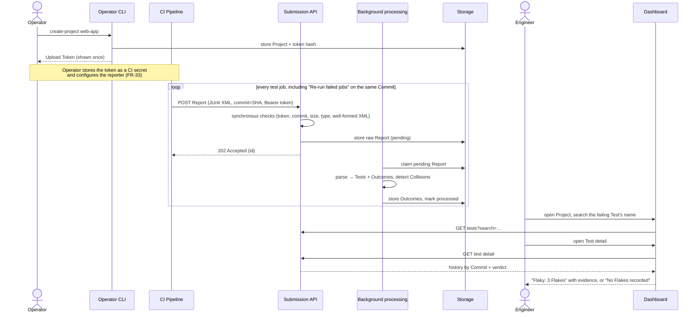
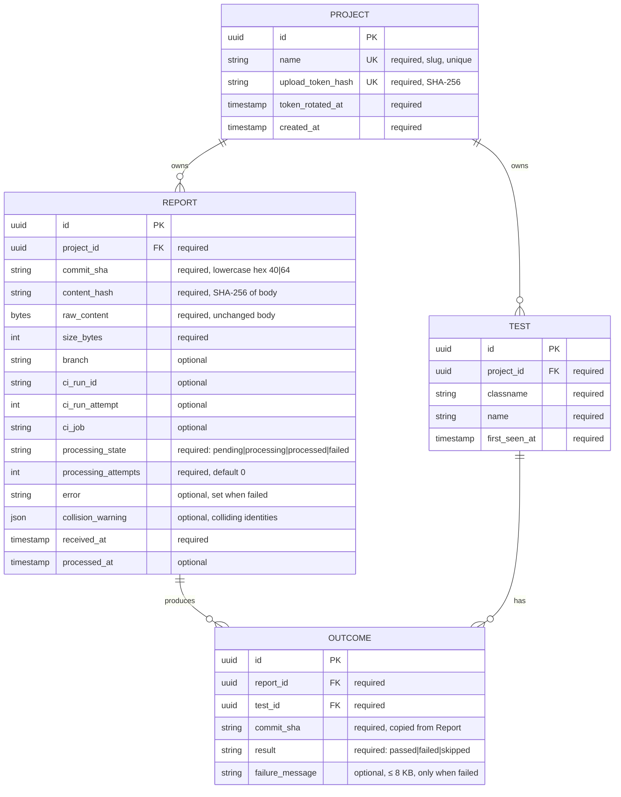
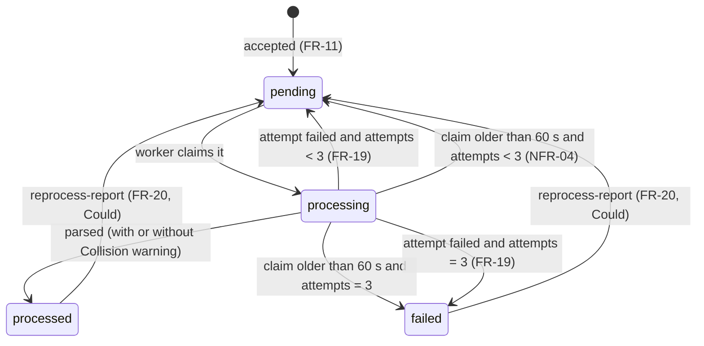

# Software Requirements Specification: Flaky Test Tracker, iteration 1

| | |
|---|---|
| Version | 1.5 (see [Document history](#18-document-history)) |
| Status | Baseline for implementation |
| Problem definition | [docs/01-problem-definition.md](01-problem-definition.md) |
| Glossary | [CONTEXT.md](../CONTEXT.md) |
| Decisions | [docs/adr/](adr/) (ADR-0001 … ADR-0005) |

Terms in **bold** are glossary terms and are used with exactly that meaning. Requirement keywords: **must** = required for iteration 1 to be accepted.

---

## 1. Purpose and product goals

The purpose, users and value are in the [problem definition](01-problem-definition.md); they are not repeated here. Iteration 1 has to prove one value loop end to end:

> A **CI Pipeline** submits **Reports**. The system finds **Flakes** (mixed **Outcomes** on the same **Commit**). An **Engineer** who looks up a failing **Test** gets a verdict with evidence: flaky, or no Flakes recorded.

Goals, each tied to a [success criterion](01-problem-definition.md#success-criteria):

| ID | Goal | Measured by |
|---|---|---|
| G1 | Correct verdicts: flaky Tests listed, broken Tests never listed | AC-19, AC-20, AC-28 |
| G2 | Verdict in at most 2 clicks from a Test name | AC-23, NFR-14 |
| G3 | No harm to CI: fast acknowledgement, and a processing failure never fails CI | NFR-01, AC-13 |
| G4 | A reviewer sees real results in ≤ 3 commands and ≤ 5 minutes | NFR-13, AC-28 |

## 2. Actors and roles

| Actor | Interface | Can do | Cannot do |
|---|---|---|---|
| **Operator** | CLI with direct access to the deployment | Create a **Project**; rotate its **Upload Token**; reprocess a **Report** (Could) | Nothing is restricted. The Operator has full access to the deployment. |
| **CI Pipeline** | HTTP, authenticated with an **Upload Token** | Submit a **Report** to the one **Project** the token belongs to | Read any data; touch other Projects |
| **Engineer** | Dashboard, no login | Read every Project's Flaky Tests, Tests, Test detail and Reports | Change anything |
| **Tech Lead** | Dashboard, no login | Same as Engineer | Same as Engineer |

There are **no user roles** in iteration 1. The Engineer and the Tech Lead are personas with identical, read-only access. Writing data is controlled by *channel*, not by role: the CLI is only reachable by the Operator, and the submission endpoint requires a token. See [ADR-0002](adr/0002-upload-token-auth-no-user-login.md).

## 3. Glossary

All domain terms are defined in [CONTEXT.md](../CONTEXT.md): Engineer, Tech Lead, CI Pipeline, Operator, Project, Upload Token, Report, Commit, Test, Collision, Outcome, Flaky Test, Flake.

Terms specific to this document (requirements vocabulary, not domain language):

| Term | Meaning |
|---|---|
| Ranking window | The period, ending now, within which Flakes count towards ranking. Default 14 days (FR-22). |
| Flake time | The receipt time of the most recent Report that contributed an Outcome to a Flake's Test and Commit. |
| Processing state | The lifecycle state of a Report (§8). |
| Verdict | What Test detail says: "Flaky: N Flakes" or "No Flakes recorded". |

## 4. Use cases and workflows

### UC-1 (core vertical slice): from a red build to a verdict



### UC-2: Tech Lead prioritises fixes
The Tech Lead opens a Project's Flaky Tests list (FR-27). It's ranked by Flakes in the ranking window, so the top entries cost the team the most re-runs.

### UC-3: Operator checks that data is arriving
The Operator opens the Reports page (FR-30) and sees each Report's processing state, its error (if failed) and its Collision warning (if any).

### UC-4: Operator rotates a leaked Upload Token
`rotate-token <project>` issues a new token. The old one is rejected from then on (FR-03).

### UC-5: Reviewer runs the demo
`docker compose up` → `npm run demo` → open the dashboard. The demo runs a genuinely flaky Vitest suite 10 times on the current Commit and submits each real Report through the same endpoint CI uses (FR-31, FR-32).

## 5. Functional requirements

Priorities use MoSCoW for iteration 1: **M**ust, **S**hould, **C**ould, **W**on't.

### 5.1 Projects and Upload Tokens (Operator CLI)

| ID | Requirement | Priority |
|---|---|---|
| FR-01 | The Operator can create a Project with `create-project <name>`. The name must match `^[a-z0-9][a-z0-9-]{0,99}$` and be unique. The command prints the Project ID, the name and a newly generated Upload Token. | M |
| FR-02 | An Upload Token is shown only at creation or rotation. The system stores only its SHA-256 hash and never logs or returns the token afterwards. | M |
| FR-03 | The Operator can run `rotate-token <name>`. This issues and prints a new Upload Token, and from that moment the previous token is rejected. | M |
| FR-04 | CLI commands exit with code 0 on success and a non-zero code with a one-line message on error (unknown Project, duplicate or invalid name). | M |

### 5.2 Submitting a Report

| ID | Requirement | Priority |
|---|---|---|
| FR-05 | The CI Pipeline submits a Report with `POST /api/v1/reports`. The body is the JUnit XML document, `Content-Type` is `application/xml` or `text/xml`, the token goes in `Authorization: Bearer <Upload Token>`, and metadata goes in query parameters (§9.2). The Project is determined by the token. | M |
| FR-06 | A submission without a valid Upload Token is rejected with `401`, and nothing is stored. | M |
| FR-07 | `commit` is required: 40 or 64 hexadecimal characters, case-insensitive, stored in lowercase. A missing or malformed value is rejected with `400 INVALID_COMMIT`. | M |
| FR-08 | Optional metadata is stored as received: `branch` (≤ 255 chars), `runId` (≤ 64 chars), `runAttempt` (integer ≥ 1), `job` (≤ 255 chars). An invalid value is rejected with `400 VALIDATION_ERROR`. | M |
| FR-09 | Body checks: an empty body gets `400 EMPTY_REPORT`; a body over 10 MB gets `413 REPORT_TOO_LARGE`; any other content type gets `415 UNSUPPORTED_MEDIA_TYPE`. | M |
| FR-10 | The body must be well-formed XML, contain no DOCTYPE declaration, and have a root element of `testsuites` or `testsuite`. Otherwise it is rejected with `422 MALFORMED_REPORT`. | M |
| FR-11 | An accepted Report is stored unchanged, byte for byte, with processing state `pending`, and the response is `202` with its ID. | M |
| FR-12 | A submission with the same Project, the same Commit and byte-identical content as an existing Report is a duplicate. It gets `200` with the existing Report's ID, its current processing state and `"duplicate": true`. Nothing new is stored. | M |

### 5.3 Processing

| ID | Requirement | Priority |
|---|---|---|
| FR-13 | Each `pending` Report is processed in the background, separately from the submission request. | M |
| FR-14 | Each `<testcase>` is mapped to a Test by Project + `classname` + `name`, exactly as reported. A Test that doesn't exist yet is created. ([ADR-0005](adr/0005-test-identity-is-classname-and-name-with-collision-detection.md)) | M |
| FR-15 | Each `<testcase>` produces one Outcome. A `<failure>` or `<error>` child → `failed`; a `<skipped>` child → `skipped`; none of these → `passed`. Other attributes, including `<testsuite hostname>`, are ignored. | M |
| FR-16 | A failed Outcome keeps a failure message: the `message` attribute and the element text of the first `<failure>`/`<error>`, joined and truncated to 8 KB (UTF-8, cut on a character boundary). | M |
| FR-17 | If one Report contains the same `classname` + `name` more than once (a Collision), no Outcome is recorded for those test cases from that Report. The Report is still `processed`, and it carries a warning that lists the colliding identities and the fixing options (`includeProjectInTestName: true` for Playwright, a `classNameTemplate` with `{filepath}` for jest-junit). | M |
| FR-18 | Processing is idempotent: processing a Report more than once never creates duplicate Outcomes. | M |
| FR-19 | If processing fails (for example a well-formed XML document that has no `<testcase>` structure the parser can read), it is retried up to 3 attempts in total with increasing delay. After that the Report is `failed`, with an error message of at most 1 KB. | M |
| FR-20 | The Operator can run `reprocess-report <reportId>` to return a `processed` or `failed` Report to `pending`. | C |

### 5.4 Analysis

| ID | Requirement | Priority |
|---|---|---|
| FR-21 | A Flake exists for a Test and Commit when, across all of the Project's Reports, that Test has at least one `passed` and at least one `failed` Outcome on that Commit. `skipped` Outcomes are ignored. ([ADR-0004](adr/0004-flakiness-means-mixed-outcomes-on-the-same-commit.md)) | M |
| FR-22 | The ranking window defaults to 14 days and the Operator can change it in deployment configuration (whole days, 1–90). | M |
| FR-23 | The Flaky Tests list contains every Test with at least one Flake whose Flake time falls inside the ranking window. It is ordered by the number of such Flakes (descending), then by the most recent Flake time (descending), then by `name` (ascending). | M |
| FR-24 | Test search finds Tests in a Project whose `name` or `classname` contains the query, case-insensitive. The query must be 2–200 characters. Results are sorted by `name` and capped at 50. Tests with no Flakes are included. | M |
| FR-25 | Test detail returns the Test's identity, its verdict, and its history over the last 50 Commits it ran on, newest first. For each Commit: counts of passed, failed and skipped Outcomes, whether it is a Flake, the failure messages, and the Report metadata (branch, runId, runAttempt, job, received time). The verdict is "Flaky" with the total number of Flakes and the number inside the ranking window if there is at least one Flake; otherwise "No Flakes recorded". | M |

### 5.5 Dashboard (read-only, no login)

| ID | Requirement | Priority |
|---|---|---|
| FR-26 | The **Projects page** lists all Projects by name. Each one links to its Flaky Tests page. | M |
| FR-27 | The **Flaky Tests page** shows FR-23 for one Project: Test `name`, `classname`, Flake count in the window, and most recent Flake time. Each row links to Test detail. When the list is empty, the page says so. | M |
| FR-28 | The Flaky Tests page has a **Test search** field (FR-24) that shows matching Tests. Each result links to Test detail. | M |
| FR-29 | The **Test detail page** shows FR-25. The verdict is the first element on the page. | M |
| FR-30 | The **Reports page** lists a Project's 100 most recent Reports, newest first, with received time, Commit (short SHA), branch, runAttempt, job, processing state, error (if `failed`) and Collision warning (if any). | M |

### 5.6 Demo, integration and documentation

| ID | Requirement | Priority |
|---|---|---|
| FR-31 | The repository contains a Vitest fixture suite with at least 3 genuinely flaky tests, based on the completion-order race validated by the prototype, 1 test that always fails, and at least 1 test that always passes. No test's outcome depends on an attempt counter, a seed or an environment variable. | M |
| FR-32 | `npm run demo` creates (or reuses) a Project named `demo`, runs the fixture suite 10 times with Vitest's built-in JUnit reporter, submits each Report through `POST /api/v1/reports` with the current git `HEAD` as the Commit, waits until all of them leave `pending`/`processing`, and prints the dashboard URL. | M |
| FR-33 | The setup documentation gives a CI step to copy for GitHub Actions (using `GITHUB_SHA`, `GITHUB_REF_NAME`, `GITHUB_RUN_ID`, `GITHUB_RUN_ATTEMPT`, `GITHUB_JOB`), plus the reporter configuration required per runner: Vitest default; Playwright `includeProjectInTestName: true` when there is more than one project; jest-junit `classNameTemplate` containing `{filepath}`. | M |
| FR-34 | This repository's GitHub Actions workflow runs the fixture suite and submits Reports to the API running inside the same job, using only `GITHUB_*` variables and a token. | S |
| FR-35 | `npm run demo:playwright` does the same as FR-32 with a Playwright fixture suite (it needs browser installs). | C |

### 5.7 Won't (iteration 1)

Listed so they aren't mistaken for omissions: user login or RBAC; managing Projects from the dashboard; Organisations; a Run entity; tracking Tests across renames; statistical flakiness; using retries as a signal; feedback inside CI; trend charts; quarantining; notifications; formats other than JUnit XML; retention or deletion. Each one's reason is in the [problem definition's non-goals](01-problem-definition.md#non-goals-deliberately-not-in-iteration-1).

## 6. Non-functional requirements

"Laptop setup" means the documented `docker compose` stack on a developer laptop (reference: Apple M1, 8 cores, 16 GB).

| ID | Category | Requirement and measurable target |
|---|---|---|
| NFR-01 | Performance | Submission: p95 time to acknowledge < **300 ms** for a 1 MB Report at **10 requests/s** sustained for 60 s, laptop setup (k6). |
| NFR-02 | Performance | Processing: a Report with **1,000** test cases goes from `pending` to `processed` in < **5 s** p95, laptop setup, with nothing else queued. |
| NFR-03 | Performance | Read APIs (Flaky Tests list, Test search, Test detail): p95 < **500 ms** with **10,000** Tests and **200,000** Outcomes in one Project, laptop setup. |
| NFR-04 | Reliability | No accepted Report is lost. If the background worker is killed while processing, the Report returns to `pending` within **60 s** and is then processed exactly once in effect (FR-18). |
| NFR-05 | Reliability | Submission does not depend on processing. With the background worker stopped, submissions still get `202`, and they are processed after it restarts. |
| NFR-06 | Security | An Upload Token has ≥ **256 bits** of randomness, is prefixed `ftt_` so secret scanners can recognise it, and is compared by hash. A token value never appears in logs or API responses, apart from the one CLI output. |
| NFR-07 | Security | XML parsing never resolves DTDs or external entities. A Report containing a DOCTYPE is rejected (FR-10). An XXE payload never causes a file read or network call. |
| NFR-08 | Security | All text that comes from a Report (Test names, `classname`, failure messages, metadata) is rendered as text in the dashboard, never as HTML. |
| NFR-09 | Accessibility | Every dashboard page has **0** serious or critical axe-core violations and can be fully used by keyboard (search, links, navigation). |
| NFR-10 | Observability | Logs are structured JSON. Each HTTP log line carries a request ID, also returned as the `X-Request-Id` header. Each processing state change logs one line with the Report ID and the new state. |
| NFR-11 | Observability | `GET /health` returns `200` when the database is reachable and `503` otherwise. |
| NFR-12 | Maintainability | Lint and typecheck pass with 0 errors. The JUnit interpretation module (parsing, Outcome mapping, Collisions, truncation) has ≥ **90%** line coverage from unit tests. Flake detection runs as SQL and is covered by integration tests against real PostgreSQL (AC-19 … AC-22). |
| NFR-13 | Portability | From a fresh clone, with only Docker and Node installed and no cloud accounts or paid services, `docker compose up`, `npm run demo` and opening the printed URL show populated results in ≤ **5 minutes** (excluding image download time on first run). |
| NFR-14 | Usability | From a Project's Flaky Tests page, an Engineer reaches a Test's verdict in ≤ **2 clicks** after typing its name (search result → Test detail). |

## 7. Data model



| Rule | Purpose |
|---|---|
| `REPORT` unique on (`project_id`, `commit_sha`, `content_hash`) | Duplicate detection (FR-12) |
| `TEST` unique on (`project_id`, `classname`, `name`) | Test identity (FR-14, ADR-0005) |
| `OUTCOME` unique on (`report_id`, `test_id`) | Idempotent processing (FR-18). Possible because Collisions record no Outcomes (FR-17). |
| `OUTCOME.commit_sha` is copied from its Report | Flake detection groups by (`test_id`, `commit_sha`) without a join |

- **Ownership.** Every row belongs to exactly one Project, directly or through its Report or Test (ADR-0001). No Project-level deletion exists in iteration 1.
- **Flake is derived, not stored.** It's the set of (`test_id`, `commit_sha`) groups that contain both a `passed` and a `failed` Outcome. Whether to compute it on read or materialise it is a design decision constrained by NFR-03.
- **Raw content storage** (database column vs. file or object storage) is a design decision. The requirement is only "unchanged and retrievable" (FR-11, ADR-0003).
- **Commit is an attribute, not an entity.**

## 8. State machine: Report processing



| From \ To | pending | processing | processed | failed |
|---|---|---|---|---|
| (new) | ✅ on acceptance | ❌ | ❌ | ❌ |
| pending | n/a | ✅ claim | ❌ must be processed first | ❌ must be processed first |
| processing | ✅ retry or expired claim (attempts < 3) | n/a | ✅ | ✅ after the 3rd attempt, failed or expired |
| processed | ✅ reprocess only | ❌ | n/a | ❌ |
| failed | ✅ reprocess only | ❌ | ❌ | n/a |

- A rejected submission (`4xx`) never creates a Report, so it has no state.
- A duplicate submission (FR-12) doesn't change the existing Report's state.
- A Report is never deleted in iteration 1.

## 9. Interfaces

### 9.1 Conventions

- REST over HTTP with JSON responses. All application routes are under `/api/v1`.
- Read endpoints need no authentication (ADR-0002). Only `POST /api/v1/reports` requires an Upload Token.
- Timestamps are ISO 8601 in UTC. IDs are UUIDs.
- **Error envelope**, used for every non-2xx response:

```json
{
  "error": {
    "code": "INVALID_COMMIT",
    "message": "commit must be 40 or 64 hexadecimal characters",
    "details": { "field": "commit" },
    "requestId": "8d1c…"
  }
}
```

| HTTP | `code` |
|---|---|
| 400 | `INVALID_COMMIT`, `EMPTY_REPORT`, `VALIDATION_ERROR` |
| 401 | `UNAUTHORIZED` (missing, malformed or unknown token, with the same message in every case) |
| 404 | `NOT_FOUND` |
| 413 | `REPORT_TOO_LARGE` |
| 415 | `UNSUPPORTED_MEDIA_TYPE` |
| 422 | `MALFORMED_REPORT` |
| 500 | `INTERNAL_ERROR` (no internals in the message) |
| 503 | `UNAVAILABLE` (`/health` only) |

### 9.2 Endpoints

| Method and path | Serves | Request | Success response |
|---|---|---|---|
| `POST /api/v1/reports` | FR-05 … FR-12 | Header `Authorization: Bearer ftt_…`, header `Content-Type: application/xml`. Query: `commit` (required), `branch`, `runId`, `runAttempt`, `job`. Body: the JUnit XML. | `202 {id, processingState: "pending", duplicate: false}`, or `200 {id, processingState, duplicate: true}` |
| `GET /api/v1/projects` | FR-26 | none | `200 {items: [{id, name, createdAt}]}`, sorted by name |
| `GET /api/v1/projects/{projectId}/flaky-tests` | FR-23, FR-27 | none | `200 {windowDays, items: [{testId, classname, name, flakeCount, lastFlakeAt}]}` |
| `GET /api/v1/projects/{projectId}/tests?search=` | FR-24, FR-28 | `search`: 2–200 chars | `200 {items: [{testId, classname, name, totalFlakes}]}` |
| `GET /api/v1/projects/{projectId}/tests/{testId}` | FR-25, FR-29 | none | `200 {testId, classname, name, verdict: {flaky, totalFlakes, flakesInWindow, windowDays}, history: [{commitSha, isFlake, passed, failed, skipped, outcomes: [{result, failureMessage, reportId, branch, runId, runAttempt, job, receivedAt}]}]}` |
| `GET /api/v1/projects/{projectId}/reports` | FR-30 | none | `200 {items: [{id, commitSha, branch, runId, runAttempt, job, sizeBytes, processingState, error, collisionWarning, receivedAt, processedAt}]}` (≤ 100) |
| `GET /api/v1/projects/{projectId}/reports/{reportId}` | FR-32 (the demo waits for processing), FR-30 | none | `200` with one item in the same shape as above |
| `GET /health` | NFR-11 | none | `200 {status: "ok"}` or `503` with the error envelope |

An unknown `projectId`, `testId` or `reportId` (including a Test or Report that belongs to another Project) returns `404 NOT_FOUND`.

### 9.3 Operator CLI

| Command | Serves | Output on success |
|---|---|---|
| `create-project <name>` | FR-01, FR-02, FR-04 | Project ID, name, Upload Token |
| `rotate-token <name>` | FR-03, FR-04 | the new Upload Token |
| `reprocess-report <reportId>` | FR-20 (Could) | the new processing state (`pending`) |

The CLI runs where the deployment runs (for example `docker compose exec`). It has no network-facing surface.

## 10. Security considerations

| Topic | Requirement |
|---|---|
| Authentication | CI: Upload Token (FR-05, FR-06, NFR-06). Dashboard: none, so the deployment must be on an internal network (ADR-0002, assumption A6). Operator: the ability to run the CLI on the deployment is the credential. |
| Authorisation | A token can only create Reports for its own Project. No API reads with a token. Every Project-scoped read checks that the child resource belongs to the Project in the path (404 otherwise, §9.2). |
| Input validation | Every query parameter and body is validated before use (FR-07 … FR-10, FR-24). The Report body goes through a parser with DTDs and entity resolution disabled (NFR-07). Size is capped at 10 MB before parsing (FR-09). |
| Secrets | Upload Tokens are stored only as hashes (FR-02). Database credentials come from environment variables; an example file contains no real values. |
| Sensitive data in Reports | Failure messages may contain secrets or personal data printed by tests. Iteration 1 stores them truncated (FR-16) and does **not** redact them. The mitigation is the internal-network boundary. This is a listed risk for the validation report. |

Relevant OWASP Top 10 (2021) items:

| Item | Where it applies | Control |
|---|---|---|
| A01 Broken Access Control | Token reaching another Project; a child resource read through the wrong Project | Project derived from the token; ownership check → 404 |
| A02 Cryptographic Failures | Token storage | SHA-256 hash of a 256-bit random token (NFR-06) |
| A03 Injection | Search query, path parameters, Report content reaching the database or the UI | Parameterised queries; output rendered as text (NFR-08) |
| A04 Insecure Design | Public dashboard without login | Internal-network deployment is a documented precondition (ADR-0002) |
| A05 Security Misconfiguration | XML parser defaults (XXE) | DTDs and entities disabled; DOCTYPE rejected (NFR-07) |
| A07 Identification and Authentication Failures | Token guessing | 256-bit tokens; the same 401 for every failure reason |
| A09 Security Logging and Monitoring Failures | Tokens leaking into logs | Tokens never logged (NFR-06); request IDs (NFR-10) |

Not applicable in iteration 1: A08 (no deserialisation of objects or updates from outside, apart from XML which is covered above) and A10 SSRF (the system makes no outbound requests).

## 11. Performance and reliability expectations

- **Volume we design for:** a team of 5–50 Engineers, tens to a few hundred Reports per day per Project, suites of up to about 10k test cases. NFR-01 … NFR-03 put numbers on this.
- **Delivery semantics:** a Report is accepted at least once. Processing may run more than once and the Outcomes behave as if it ran once (FR-18, NFR-04).
- **Degradation:** if the worker is down, submissions are still accepted (NFR-05) and the dashboard shows stale data, with the Reports page making the backlog visible (`pending`).
- **No high availability** in iteration 1: a single instance of each component and a single database, with no backups (§14).

## 12. Constraints

| Constraint | Source |
|---|---|
| Total budget for the whole assignment, including docs, is about 2 working days | Engineer |
| Runs locally with `docker compose` and one documented sequence of commands; no cloud accounts and no paid services | Reviewers must be able to run it (NFR-13) |
| TypeScript on Node.js for the services and the dashboard; PostgreSQL for relational data. Specific frameworks are chosen and justified in the design (step 3). | Stack the team already runs; relational data model (§7) |
| JUnit XML is the only input format | ADR-0004, non-goal 9 |
| Single organisation per deployment | ADR-0001 |

## 13. Assumptions

Statuses come from the [problem definition](01-problem-definition.md#assumptions) and the prototype.

| # | Assumption | How we'd find out it's wrong | Status |
|---|---|---|---|
| A1 | Teams re-run failed jobs often enough to produce evidence on the same Commit. | Frequency of `GITHUB_RUN_ATTEMPT > 1` in a real repository | Open |
| A2 | `classname` + `name` identify a Test stably. | Prototype | Partially refuted → handled by ADR-0005 and FR-17 |
| A3 | Runner or environment differences on the same Commit rarely masquerade as flakiness. | Flakes that only appear between different `job` values | Open |
| A4 | A re-run of a `pull_request` workflow keeps the same `GITHUB_SHA`. | FR-34's workflow, re-run on a PR | Open; checked by FR-34 |
| A5 | Retries are visible in JUnit output. | Prototype | Partially confirmed → retries not used as a signal |
| A6 | An internal network is an acceptable boundary for a no-login dashboard. | Ask target teams' security or ops | Open |
| A7 | Reports stay well under 10 MB. | Size of real suites' Reports; `413` frequency | Open |
| A8 | The completion-order race fails about 50% of the time on any machine. | Prototype (host and `--cpus=0.5`); GitHub Actions via FR-34 | Confirmed locally |
| A9 | Teams that hit Collisions will act on the warning and set the reporter option. | Reports with a persistent Collision warning over several days | Open |
| A10 | Computing Flakes on read meets NFR-03 at the stated volume. | k6 or a seeded benchmark at 10k Tests / 200k Outcomes | Confirmed: `load/seed-reads.mjs` (AC-36), p95 well under 500 ms; no fallback needed |

## 14. Out of scope

Product non-goals are listed with reasons in the [problem definition](01-problem-definition.md#non-goals-deliberately-not-in-iteration-1) and summarised in §5.7. Technical non-goals for iteration 1:

| Not doing | Why |
|---|---|
| Rate limiting | Deployment is on an internal network; tokens are per Project and rotatable |
| Pagination beyond the stated caps (50 history Commits, 50 search results, 100 Reports) | The caps cover the volume in §11 |
| Horizontal scaling of the worker; an external message queue | Volume in §11. The queue sits behind an interface (ADR-0003). |
| Metrics, tracing, alerting | Logs and a health endpoint are enough for a single-instance deployment (NFR-10, NFR-11) |
| HTTPS termination, backups, high availability | Deployment concerns outside the local run |
| Token expiry | Rotation covers the leak case (FR-03) |
| Internationalisation; layouts optimised for mobile | Users are engineers at a desk; the pages must still be usable at narrow widths |
| How GitHub-hosted runners reach an internal deployment | **Open question for the design** (public submission-only endpoint vs. self-hosted runners) |

## 15. Acceptance criteria

Unless stated otherwise: a Project `web-app` exists with a valid token, and "a Report" means a well-formed JUnit XML body. Fixture XML comes from real reporter output (the prototype samples) unless stated otherwise.

### Projects and tokens

- **AC-01** (FR-01, FR-02, FR-04). **Given** no Project named `web-app`, **when** the Operator runs `create-project web-app`, **then** the command exits with 0 and prints a token starting with `ftt_`, and the stored Project contains that token's SHA-256 hash, not the token itself.
- **AC-02** (FR-01, FR-04). **Given** a Project `web-app` exists, **when** the Operator runs `create-project web-app` or `create-project Web_App`, **then** the command exits non-zero with a one-line error, and no Project is created.
- **AC-03** (FR-03, FR-06). **Given** `web-app` with token T1, **when** the Operator runs `rotate-token web-app` and gets T2, **then** a submission with T1 gets `401` and the same submission with T2 gets `202`.

### Submission

- **AC-04** (FR-05, FR-11, FR-13). **Given** a valid token, **when** CI submits a Report with `commit=<40-hex>`, **then** the response is `202` with an ID and `processingState: "pending"`, and the stored raw content is byte-identical to the request body.
- **AC-05** (FR-06, NFR-06). **Given** a submission with no `Authorization` header, a malformed one, or an unknown token, **then** each gets `401 UNAUTHORIZED` with the same message, no Report is stored, and the token value doesn't appear in the logs.
- **AC-06** (FR-07). **Given** `commit` is missing, `abc123`, 39 hex characters, or 40 characters containing `g`, **then** each gets `400 INVALID_COMMIT`. **Given** a 40-character SHA in uppercase, **then** it gets `202` and is stored in lowercase.
- **AC-07** (FR-08). **Given** `runAttempt=0` or `runAttempt=x`, **then** the response is `400 VALIDATION_ERROR`. **Given** `branch=main&runId=123&runAttempt=2&job=test`, **then** those values appear on the Report in the Reports list.
- **AC-08** (FR-09). **Given** an empty body, **then** `400 EMPTY_REPORT`. **Given** a body of 10 MB + 1 byte, **then** `413 REPORT_TOO_LARGE`. **Given** `Content-Type: application/json`, **then** `415 UNSUPPORTED_MEDIA_TYPE`.
- **AC-09** (FR-10, NFR-07). **Given** a body that is truncated XML, a body whose root is `<html>`, or a body containing `<!DOCTYPE … SYSTEM "file:///etc/passwd">`, **then** each gets `422 MALFORMED_REPORT`, and no file is read.
- **AC-10** (FR-12). **Given** a Report R was accepted for Commit C, **when** the identical body is submitted again for C, **then** the response is `200` with R's ID and `duplicate: true`, and the Project still has one Report. **When** the identical body is submitted for a different Commit D, **then** it gets `202` with a new ID.

### Processing

- **AC-11** (FR-14, FR-15, FR-16). **Given** a Vitest Report with one passing, one `<failure>`, one `<error>` and one `<skipped>` test case, **when** it is processed, **then** 4 Tests exist with `classname`/`name` exactly as in the XML, their Outcomes are passed, failed, failed and skipped, and both failed Outcomes have a failure message.
- **AC-12** (FR-16). **Given** a `<failure>` whose combined message is 20 KB of multi-byte UTF-8, **when** it is processed, **then** the stored failure message is ≤ 8 KB and is valid UTF-8.
- **AC-13** (FR-19, NFR-05). **Given** a well-formed Report with root `<testsuites>` but test cases the parser can't read, **when** it is submitted, **then** the response is still `202`, and after 3 attempts the Report is `failed`, with an error shown on the Reports page.
- **AC-14** (FR-17). **Given** a Playwright Report with two projects and no `includeProjectInTestName` (identical `classname`/`name` under `hostname="chromium"` and `hostname="firefox"`), where chromium passed and firefox failed, **when** it is processed, **then** the Report is `processed`, its Collision warning lists that identity and mentions `includeProjectInTestName`, and no Outcome (and so no Flake) is recorded for it.
- **AC-15** (FR-17, FR-14). **Given** the same Playwright suite reported with `includeProjectInTestName: true`, **when** it is processed, **then** there are two distinct Tests, one per project, and no Collision warning.
- **AC-16** (FR-18, NFR-04). **Given** a processed Report, **when** it is processed again (by reprocessing or a simulated retry), **then** the number of Outcomes for that Report doesn't change.
- **AC-17** (NFR-04). **Given** a Report in `processing` whose worker was killed, **when** 60 s have passed and the worker is running again, **then** the Report reaches `processed` and has exactly one Outcome per test case.
- **AC-18** (NFR-05). **Given** the worker is stopped, **when** 3 Reports are submitted, **then** all get `202` and stay `pending`. **When** the worker starts, **then** all 3 reach `processed`.

### Analysis

- **AC-19** (FR-21). **Given** Test X passed in Report R1 and failed in Report R2, both for Commit C, **then** X has one Flake (on C) and appears on the Flaky Tests list.
- **AC-20** (FR-21). **Given** Test Y failed in every Report on Commits C1 and C2, and Test Z passed on C1 and failed on C2 (never both on the same Commit), **then** neither Y nor Z appears on the Flaky Tests list, and both show "No Flakes recorded".
- **AC-21** (FR-21). **Given** Test S was skipped in R1 and failed in R2 on the same Commit, **then** S has no Flake.
- **AC-22** (FR-22, FR-23). **Given** Test A has 3 Flakes in the last 14 days, Test B has 1 Flake 2 days ago, Test C has 1 Flake 5 days ago, and Test D has 1 Flake 20 days ago, **when** the list is requested with the default window, **then** the order is A, B, C, and D is not listed. **Given** the window is configured to 30 days, **then** D is also listed, last.
- **AC-23** (FR-24, FR-28, NFR-14). **Given** Tests `report ingestion > parses` (no Flakes) and `checkout > pays` (2 Flakes), **when** the Engineer types `INGEST` into the search on the Flaky Tests page, **then** the first Test is shown; one click opens its detail, which shows "No Flakes recorded".
- **AC-24** (FR-24). **Given** a search query of 1 character or 201 characters, **then** the response is `400 VALIDATION_ERROR`.
- **AC-25** (FR-25, FR-29). **Given** Test X has Outcomes on 60 Commits, 2 of them Flakes, one 3 days ago and one 30 days ago, **when** its detail is opened, **then** the verdict is the first element on the page and says Flaky with 2 Flakes in total and 1 in the 14-day window, the history shows 50 Commits newest first, and each Flake Commit lists its passed and failed Outcomes with failure messages and Report metadata.

### Dashboard

- **AC-26** (FR-26, FR-27, FR-30). **Given** Projects `web-app` and `api`, **when** the Projects page is opened, **then** both are listed by name. Opening `web-app` shows its Flaky Tests page, and from there its Reports page lists its Reports newest first with their processing states.
- **AC-27** (NFR-08). **Given** a Test named ``, **when** it appears on any page, **then** it is shown as literal text and no script runs.

### Demo, integration and documentation

- **AC-28** (FR-31, FR-32, NFR-13, G1, G4). **Given** a fresh clone with Docker and Node, **when** the reviewer runs `docker compose up -d` and `npm run demo`, **then** within 5 minutes (excluding the first image download) the demo prints a dashboard URL, the `demo` Project's Flaky Tests list contains every flaky fixture test, and the always-failing fixture test is **not** listed.
- **AC-29** (FR-31). **Given** the fixture suite's source, **then** no test reads an attempt counter, a seed or an environment variable to decide its outcome (code review checklist item).
- **AC-30** (FR-33). **Given** the setup documentation, **when** its GitHub Actions step and reporter configuration are copied into a workflow, **then** the step submits a Report successfully using only `GITHUB_*` variables and the token secret.
- **AC-31** (FR-34, A4). **Given** this repository's workflow, **when** a run is re-run with "Re-run failed jobs", **then** both attempts submit Reports with the same `commit` and different `runAttempt` values.
- **AC-32** (FR-20). **Given** a `failed` Report, **when** the Operator runs `reprocess-report <id>`, **then** it returns to `pending` and is processed again.
- **AC-33** (FR-35). **Given** browsers are installed, **when** `npm run demo:playwright` runs, **then** the Playwright flaky fixtures appear on the `demo` Project's Flaky Tests list.

### Non-functional checks

- **AC-34** (NFR-01). k6 submits 1 MB Reports at 10 requests/s for 60 s on the laptop setup; p95 acknowledgement time is < 300 ms, and there are 0 non-2xx responses.
- **AC-35** (NFR-02). A Report with 1,000 test cases reaches `processed` in < 5 s, p95 over 20 submissions.
- **AC-36** (NFR-03, A10). With 10,000 Tests and 200,000 Outcomes seeded in one Project, p95 for the Flaky Tests list, Test search and Test detail is < 500 ms over 100 requests each.
- **AC-37** (NFR-09). axe-core run by Playwright on the Projects, Flaky Tests, Test detail and Reports pages reports 0 serious or critical violations. The core workflow of AC-23 can be completed with the keyboard only.
- **AC-38** (NFR-10, NFR-11). Every HTTP response has an `X-Request-Id` header that matches a JSON log line. `GET /health` returns `200` with the database up and `503` with it stopped.
- **AC-39** (NFR-12). CI runs lint and typecheck with 0 errors, and the coverage report for the JUnit interpretation module is ≥ 90% lines.

## 16. Traceability matrix

The test file column is filled in during implementation.

| Requirement | Priority | Acceptance criteria | Test file(s) |
|---|---|---|---|
| FR-01 | M | AC-01, AC-02 | `apps/api/test/projects.int.test.ts` |
| FR-02 | M | AC-01 | `apps/api/src/projects/token.test.ts`, `apps/api/test/projects.int.test.ts` |
| FR-03 | M | AC-03 | `apps/api/test/projects.int.test.ts`, `apps/api/test/report-intake.int.test.ts` |
| FR-04 | M | AC-01, AC-02 | `apps/api/test/projects.int.test.ts` |
| FR-05 | M | AC-04 | `apps/api/test/report-intake.int.test.ts` |
| FR-06 | M | AC-03, AC-05 | `apps/api/test/report-intake.int.test.ts` |
| FR-07 | M | AC-06 | `packages/contracts/src/reports.test.ts`, `apps/api/test/report-intake.int.test.ts` |
| FR-08 | M | AC-07 | `packages/contracts/src/reports.test.ts`, `apps/api/test/report-intake.int.test.ts`, `apps/api/test/read-api.int.test.ts` |
| FR-09 | M | AC-08 | `apps/api/test/report-intake.int.test.ts` |
| FR-10 | M | AC-09 | `apps/api/src/report-intake/xml-pre-check.test.ts`, `apps/api/test/report-intake.int.test.ts` |
| FR-11 | M | AC-04 | `apps/api/test/report-intake.int.test.ts` |
| FR-12 | M | AC-10 | `apps/api/test/report-intake.int.test.ts` |
| FR-13 | M | AC-04, AC-18 | `apps/api/test/report-intake.int.test.ts` (AC-04 part), `apps/api/test/report-processing.int.test.ts` (AC-18 part) |
| FR-14 | M | AC-11, AC-15 | `apps/api/src/junit/junit.test.ts`, `apps/api/test/report-processing.int.test.ts` |
| FR-15 | M | AC-11 | `apps/api/src/junit/junit.test.ts`, `apps/api/test/report-processing.int.test.ts` |
| FR-16 | M | AC-11, AC-12 | `apps/api/src/junit/junit.test.ts` |
| FR-17 | M | AC-14, AC-15 | `apps/api/src/junit/junit.test.ts`, `apps/api/test/report-processing.int.test.ts` |
| FR-18 | M | AC-16 | `apps/api/test/report-processing.int.test.ts` |
| FR-19 | M | AC-13 | `apps/api/test/report-processing.int.test.ts` |
| FR-20 | C | AC-32 | |
| FR-21 | M | AC-19, AC-20, AC-21 | `apps/api/test/flake-analysis.int.test.ts` |
| FR-22 | M | AC-22 | `apps/api/test/flake-analysis.int.test.ts` |
| FR-23 | M | AC-22 | `apps/api/test/flake-analysis.int.test.ts` |
| FR-24 | M | AC-23, AC-24 | `packages/contracts/src/tests.test.ts`, `apps/api/test/flake-analysis.int.test.ts`, `apps/api/test/read-api.int.test.ts` |
| FR-25 | M | AC-25 | `apps/api/test/flake-analysis.int.test.ts`, `apps/api/test/read-api.int.test.ts` |
| FR-26 | M | AC-26 | `apps/api/test/read-api.int.test.ts`, `apps/web/e2e/reports.spec.ts`, `apps/web/e2e/core-workflow.spec.ts` |
| FR-27 | M | AC-26 | `apps/api/test/read-api.int.test.ts`, `apps/web/e2e/reports.spec.ts`, `apps/web/e2e/core-workflow.spec.ts` |
| FR-28 | M | AC-23 | `apps/web/e2e/test-search-and-detail.spec.ts`, `apps/web/e2e/core-workflow.spec.ts` |
| FR-29 | M | AC-25 | `apps/web/e2e/test-search-and-detail.spec.ts`, `apps/web/e2e/core-workflow.spec.ts` |
| FR-30 | M | AC-26 | `apps/api/test/read-api.int.test.ts`, `apps/web/e2e/reports.spec.ts` (state is always `pending` for now), `apps/web/e2e/core-workflow.spec.ts` |
| FR-31 | M | AC-28, AC-29 | `fixtures/flaky-suite/tests/` (AC-29: code-review checklist item, see commit message) |
| FR-32 | M | AC-28 | `scripts/demo.sh`, `apps/web/e2e/reviewer-demo.spec.ts` |
| FR-33 | M | AC-30 | `.github/actions/submit-report/test/submit.test.sh` |
| FR-34 | S | AC-31 | `.github/workflows/ci.yml` (`dogfood` job), `scripts/dogfood.sh` |
| FR-35 | C | AC-33 | |
| NFR-01 | | AC-34 | `load/k6-submit.js` |
| NFR-02 | | AC-35 | `load/processing.mjs` |
| NFR-03 | | AC-36 | `load/seed-reads.mjs` |
| NFR-04 | | AC-16, AC-17 | `apps/api/test/report-processing.int.test.ts` |
| NFR-05 | | AC-13, AC-18 | `apps/api/test/report-processing.int.test.ts` |
| NFR-06 | | AC-05 | `apps/api/src/projects/token.test.ts`, `apps/api/test/report-intake.int.test.ts`, `apps/api/test/observability.int.test.ts` |
| NFR-07 | | AC-09 | `apps/api/src/report-intake/xml-pre-check.test.ts`, `apps/api/test/report-intake.int.test.ts` |
| NFR-08 | | AC-27 | `eslint.config.js` (`no-restricted-syntax` bans `dangerouslySetInnerHTML`), `apps/web/e2e/xss-safety.spec.ts` |
| NFR-09 | | AC-37 | `apps/web/e2e/accessibility.spec.ts` |
| NFR-10 | | AC-38 | `apps/api/test/observability.int.test.ts` |
| NFR-11 | | AC-38 | `apps/api/test/health.int.test.ts` (health `200`/`503`), `apps/api/test/observability.int.test.ts` (`X-Request-Id`) |
| NFR-12 | | AC-39 | `.github/workflows/ci.yml` jobs `lint-typecheck` (lint and typecheck) and `unit` (coverage gate: `apps/api/vitest.config.ts` thresholds on `apps/api/src/junit/**`, enforced by `npm run test:unit`, design §11) |
| NFR-13 | | AC-28 | `apps/web/e2e/smoke.spec.ts`, `scripts/demo.sh`, `apps/web/e2e/reviewer-demo.spec.ts` |
| NFR-14 | | AC-23 | `apps/web/e2e/test-search-and-detail.spec.ts`, `apps/web/e2e/core-workflow.spec.ts` |

## 17. Consistency review (v1.0)

Checked after drafting:
- every Must FR has at least one AC;
- every AC traces to a requirement;
- every entity is used by an FR (Project: FR-01; Report: FR-11; Test: FR-14; Outcome: FR-15);
- every endpoint serves an FR or NFR (§9.2);
- terms match `CONTEXT.md`;
- no ADR is contradicted.

Problems found and fixed while drafting:

1. **Success criterion 2 couldn't be met for Tests that never flaked.** They aren't on the Flaky Tests list, so the Engineer couldn't reach a verdict. Fixed by adding Test search over all Tests (FR-24, FR-28) and the "No Flakes recorded" verdict (FR-25).
2. **The problem definition listed three processing states** (pending, processed, failed). The claim-and-expire behaviour needed for NFR-04 requires a fourth, `processing`. The problem definition is updated to match.
3. **"Same content" for duplicates was ambiguous** for an identical body submitted for a different Commit. Defined as same Project + same Commit + identical content (FR-12, AC-10), and `CONTEXT.md` updated.
4. **`GET …/reports/{reportId}` at first served no requirement.** It's now the way the demo waits for processing (FR-32). Without it, the demo would have to poll the whole list.
5. **The NFR "no harm to CI" had no check for processing failures.** AC-13 now asserts `202` for a Report that later fails.
6. **Idempotency (FR-18) and Collisions (FR-17) interact.** The unique constraint on (`report_id`, `test_id`) only holds because colliding test cases record no Outcomes. This dependency is stated in §7 so a design change to Collision handling doesn't silently break idempotency.
7. **Playwright's `hostname` attribute** could be read as Test identity in an implementation. FR-15 now says explicitly that `hostname` is ignored (ADR-0005).
8. **Wrong FR numbers in the use cases** (§4) after the FR list was renumbered. Corrected: UC-1 → FR-33, UC-2 → FR-27, UC-3 → FR-30, UC-5 → FR-31/FR-32.

## 18. Document history

| Version | Date | Change | Reason |
|---|---|---|---|
| 1.0 | 2026-10-13 | Initial baseline for iteration 1 | Derived from the problem definition, ADR-0001 … 0005 and the reporter-output prototype |
| 1.1 | 2026-10-13 | (1) An expired claim counts as an attempt: after the 3rd, the Report becomes `failed` instead of returning to `pending` (§8). (2) NFR-12 / AC-39 coverage target narrowed to the JUnit interpretation module; Flake detection is covered by integration tests. | Found during design: (1) without it, a Report that crashes the worker every time would loop forever; (2) the design computes Flakes in SQL (design §6), which unit-test coverage can't measure, while integration tests against real PostgreSQL can |
| 1.2 | 2026-10-13 | No requirement changed. Design corrected (design §2, §4, §8, §10): Node ≥ 22.22; deep-import lint via `eslint-plugin-import-x`; the test-naming rule allows a requirement or ADR ID when no AC covers the test; the web client's unit tests may stub `fetch`; nginx also proxies `/health`; `db` is published on host port 5433. Traceability matrix: first test files for NFR-11, NFR-12, NFR-13. | Found while implementing ticket 01: React Router 8.4 and Testcontainers 12.2 require Node ≥ 22.22, not the ≥ 22.12 the design assumed; `eslint-plugin-import` has no ESLint 10 support; ticket 01 itself asks for tests that no AC covers (the `500` mapping); a native PostgreSQL on the host shadowed port 5432 |
| 1.3 | 2026-10-13 | No requirement changed. Design corrected (design §4): ReportIntake's documented interface now includes `listForProject`/`findOne`, and the module diagram gets a `readapi --> intake` edge, naming it as the Report table's read owner. Traceability matrix: test files for FR-01 … FR-08, FR-11, FR-13 (partial), FR-26, FR-30, NFR-06. | Found while implementing ticket 02: the design never named which module owns Report *reads* for ReadApi (only ReportQueue, arriving in ticket 03, was given Report-table methods), so the first implementation had `ReadApi` query `PrismaService` directly — a documented-standard violation caught by code review. Reusing `ReportIntake`, which already owns the table's writes, closes the gap without inventing a new module ticket 02 doesn't need. |
| 1.4 | 2026-10-13 | No requirement changed. Design corrected (design §7): predefined XML entities (`&gt;` etc.) are decoded, not disabled via `processEntities: false` as design §7 said. Traceability matrix: test files for FR-13 … FR-17, NFR-12. | Found while implementing ticket 03: `processEntities: false` is all-or-nothing in fast-xml-parser and would have left Vitest's `&gt;`-escaped `name` attributes undecoded, breaking "identity exactly as reported" (FR-14, AC-11) — the library's entity decoder already caps expansion size/depth and screens custom entity values regardless of the toggle, so NFR-07's actual XXE concern (DOCTYPE, external entities) is unaffected. Also found: a Report whose root is a bare `<testsuite>` (no `<testsuites>` wrapper) — a shape already used by this repo's own `SAMPLE_JUNIT_XML` test fixture — silently produced zero Tests/Outcomes while the Report still reported `processed`; `interpret` now accepts both shapes. |
| 1.5 | 2026-10-14 | No requirement changed. Design corrected (design §10): `apps/web/nginx.conf` now sets `client_max_body_size 10m` on `/api/` to match the API's own raw-body limit (`REPORT_BODY_LIMIT` in `apps/api/src/app.ts`). A10 resolved (§13): confirmed, not just open. | Found while implementing ticket 12 (AC-34): nginx's 1 MB default silently `413`'d a 1 MB Report before it reached the API — the only entry point the Compose stack exposes (`web`, port 8080) — so NFR-01 couldn't even be measured, let alone met, until this was fixed. Also confirmed A10: `load/seed-reads.mjs` measured the on-read Flake query at 10k Tests / 200k Outcomes well under NFR-03's 500 ms, so the per-(Test, Commit) summary fallback (design §6) was not needed. |
