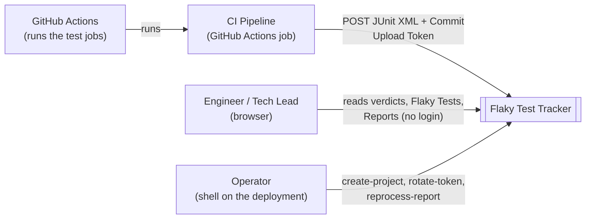
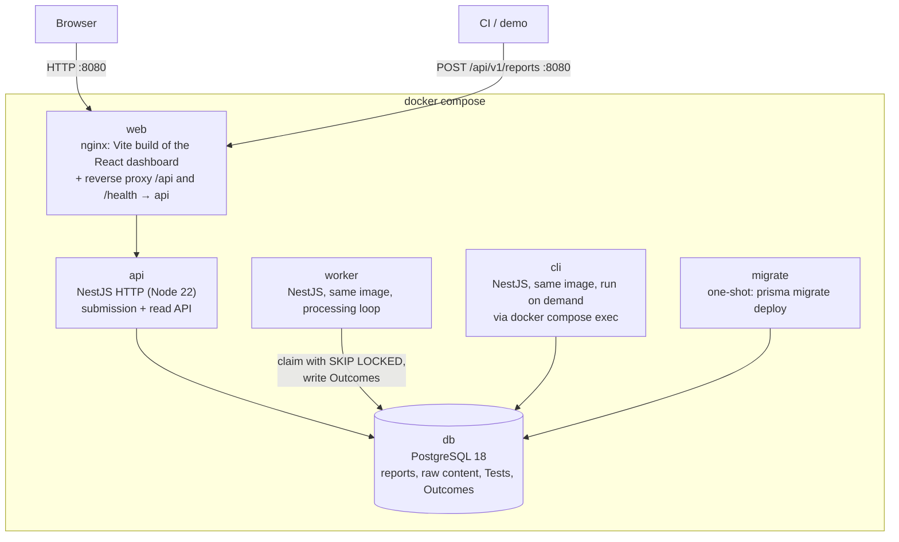
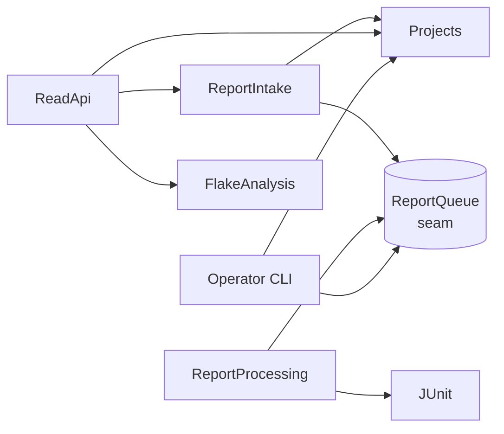
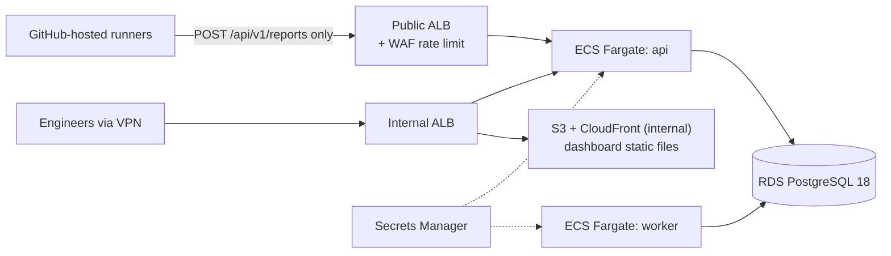
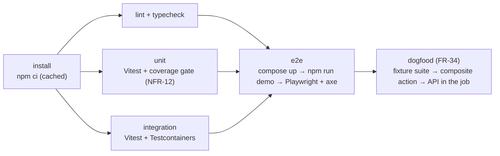

# Solution Design: Flaky Test Tracker, iteration 1

| | |
|---|---|
| Implements | [SRS v1.7](02-srs.md) |
| Glossary | [CONTEXT.md](../CONTEXT.md) |
| Decisions | [ADR-0001 … ADR-0013](adr/) |

This document says **how** iteration 1 is built and **why this way rather than a reasonable alternative**. Requirements live in the SRS and are referenced by ID. Component vocabulary follows *A Philosophy of Software Design*: a **module** has an **interface** (everything a caller must know) and an **implementation**; a module is **deep** when a lot of behaviour sits behind a small interface; a **seam** is where an interface lives; an **adapter** fills a seam.

---

## 1. Architecture overview

**Style: a modular monolith run as two processes, `api` and `worker`, plus a CLI** ([ADR-0006](adr/0006-modular-monolith-with-separate-api-and-worker-processes.md)). The SRS requires submission to keep working while processing is down (NFR-05) and a killed worker not to lose Reports (NFR-04). That rules out a single process, but nothing in the volume (SRS §11) justifies separate services.

### C4 level 1: system context



### C4 level 2: containers (as run by `docker compose`)



- `api` and `worker` never call each other. **The database is the only integration point**: a Report row in state `pending` is the job ([ADR-0011](adr/0011-report-table-is-the-job-queue.md)).
- The browser and CI both reach the system through `web` (one origin, port 8080), so there's no CORS to configure (§7).

## 2. Technology stack

Versions are pinned to the current stable releases as of 2026-10-13. Compatibility was checked against each package's declared peer dependencies.

| Layer | Choice | Version | Why | Alternative considered |
|---|---|---|---|---|
| Runtime | Node.js LTS | 22.x, **≥ 22.22** (`.nvmrc` 22.23.3, `node:22.23-alpine`) | Meets every package's minimum: React Router 8.4 and Testcontainers 12.2 need ≥ 22.22 (Prisma alone needs ≥ 22.12); supported until 2027-04; what reviewers most likely have | Node 24 LTS: newer, but forces most reviewers to upgrade first |
| Language | TypeScript | **6.0.x** | `@nestjs/cli` 12 depends on `typescript ~6.0` | TS 7.0 (the native Go port) is "latest" but not yet what the Nest toolchain uses |
| Backend framework | NestJS | 12.1 | Company stack; modules and dependency injection map onto our module boundaries; a standalone context gives us the worker and CLI from the same modules | Fastify without Nest: less structure for three entry points |
| ORM / migrations | Prisma + `@prisma/adapter-pg` | **7.10.x** (pinned; `prisma@latest` is an 8.0 RC) | [ADR-0008](adr/0008-prisma-orm-with-raw-sql-for-hot-queries.md) | TypeORM 1.1 |
| Database | PostgreSQL | 18 | Relational model; `SKIP LOCKED` queue; `bytea` raw storage ([ADR-0012](adr/0012-raw-report-content-stored-in-postgres.md)) | Postgres 19 is still in beta |
| Contracts and validation | Zod | 4.x | [ADR-0013](adr/0013-shared-zod-contracts-package.md); `nestjs-zod` excluded because it doesn't support Nest 12 | class-validator DTOs; OpenAPI codegen |
| XML parsing | fast-xml-parser | 5.x | Actively maintained; includes `XMLValidator` for the well-formedness check (FR-10); entity processing can be turned off (NFR-07); already used by the prototype | saxes: streaming, but last released in 2022 |
| Logging | nestjs-pino + pino | 5.x / 10.x | Structured JSON, request IDs (NFR-10); supports Nest 12 | Nest's built-in logger: not structured |
| Frontend | React | 19.3 | Company stack | n/a |
| Build | Vite + `@vitejs/plugin-react` | 8.x / 6.x | Company stack | n/a |
| UI kit | MUI (Emotion) | 9.x (peer `react ^19`) | Company stack; accessible components out of the box help NFR-09 | n/a |
| Routing / data | React Router, TanStack Query | 8.x / 5.x | Four routes; caching and loading states without hand-written state code | Hand-rolled `fetch` plus `useEffect` |
| Unit and integration tests | Vitest | 5.0 (peer `vite ^8`) | Company stack; one runner for api, web and contracts | Jest |
| Database for tests | `@testcontainers/postgresql` | 12.x | [ADR-0010](adr/0010-integration-tests-against-real-postgres-via-testcontainers.md) | the compose database; pg-mem |
| E2E and accessibility | Playwright + `@axe-core/playwright` | 1.64 / 4.x | Company stack; covers AC-23, AC-27, AC-37 | Cypress |
| Load | k6 (`grafana/k6` image) | 1.8 | NFR-01 has a load target (10 requests/s), so k6 is justified | autocannon |
| Containers | Docker Compose | v2 | One-command local run (NFR-13) | n/a |

### Parts of the company stack deliberately not used

| Not used | Why not, for this problem | What would have to be true to use it |
|---|---|---|
| **gRPC** | The clients are `curl` in CI and a browser; there are no service-to-service calls ([ADR-0009](adr/0009-rest-over-grpc.md)) | Internal services calling each other synchronously at high rate |
| **SQS / EventBridge** | One job type at a few hundred jobs a day; a Postgres-backed queue keeps the state in one place ([ADR-0011](adr/0011-report-table-is-the-job-queue.md)) | Worker throughput or isolation needs exceeding one database, or other systems needing to react to "Report processed" events (EventBridge) |
| **Lambda** | Processing is short and steady; a long-running worker is simpler and runs locally | Very spiky submission volume where idle cost matters |
| **S3** | Atomic writes with the Report row; no retention yet ([ADR-0012](adr/0012-raw-report-content-stored-in-postgres.md)) | Database size or backup time becoming a problem; a retention policy |
| **Cognito / Keycloak, OAuth2, RBAC** | No action yet differs between people; CI is a machine using a token ([ADR-0002](adr/0002-upload-token-auth-no-user-login.md)) | The dashboard leaving the internal network, or a privileged action in the UI (quarantine, Project management) |
| **Kubernetes** | Three long-running containers; Compose locally and ECS in the production sketch are enough | Many services, or a platform team already running it |
| **Terraform** | Nothing is deployed in iteration 1 | The first real deployment (§10); this is where the IaC would go |

## 3. Repository layout

[ADR-0007](adr/0007-monorepo-with-npm-workspaces.md): one repository, **npm workspaces**, no monorepo build tool. npm ships with Node, which satisfies NFR-13 literally; pnpm would need an extra install now that Corepack isn't bundled.

```
.
├── apps/
│   ├── api/                  NestJS: three entry points (main, worker, cli) over shared modules
│   │   ├── prisma/           schema.prisma + migrations
│   │   └── src/
│   │       ├── projects/     §4 modules (one folder each)
│   │       ├── report-intake/
│   │       ├── report-processing/
│   │       ├── junit/        pure domain module, no Nest, no I/O
│   │       ├── flake-analysis/
│   │       ├── read-api/
│   │       └── platform/     database, logging, config, error envelope, health
│   └── web/                  React + Vite + MUI
│       └── src/features/{projects,flaky-tests,test-detail,reports}
├── packages/
│   └── contracts/            Zod schemas + inferred types (ADR-0013)
├── fixtures/
│   └── flaky-suite/          genuinely flaky Vitest suite (FR-31), not part of the product
├── scripts/demo.sh           `npm run demo` (FR-32)
├── load/                     k6 script (AC-34) and the seeding/measurement scripts (AC-35, AC-36)
├── .github/
│   ├── workflows/ci.yml
│   └── actions/submit-report/   composite action wrapping curl (FR-33, FR-34)
├── docker-compose.yml
└── docs/
```

## 4. Modules and their seams

The rule for every module: callers (and tests) use only its interface. Modules talk to each other only through those interfaces (the Nest module's exports). An `index.ts` re-exports the public surface, and lint forbids deep imports into another module's folder (`import-x/no-restricted-paths`, with one zone per folder under `apps/api/src` derived in `eslint.config.js`, so new modules are covered automatically). The rule uses `eslint-plugin-import-x`, because `eslint-plugin-import` doesn't support ESLint 10.



| Module | Responsibility | Interface (what callers know) | Must NOT know about |
|---|---|---|---|
| **Projects** | Projects and Upload Tokens: create, rotate, resolve a token to a Project | `create(name) → {project, token}`, `rotateToken(name) → token`, `authenticate(bearer) → Project \| null`, `list()`, `get(id)`. Invariants: tokens are returned only by `create`/`rotateToken`; only hashes are stored (FR-02, NFR-06). | HTTP, Reports, XML |
| **ReportIntake** | Turn one HTTP submission into a stored `pending` Report, or a typed rejection (FR-05 … FR-12); also the Report table's read owner for ReadApi (FR-30), since no other module claims it until ReportQueue's lifecycle methods land in ticket 03 | `submit({project, commit, metadata, contentType, body}) → {report, duplicate}`, or one of the rejection errors from §5; `listForProject(projectId, limit) → Report[]`, `findOne(projectId, reportId) → Report \| null`. | Parsing test cases, Outcomes, Flakes |
| **ReportQueue** (seam) | The Report lifecycle as a queue: claim, complete, retry, fail, expire (SRS §8) | `claimNext(now) → Report \| null`, `complete(id, result)`, `fail(id, error, now)`, `releaseExpired(now)`, `requeue(id)`. Adapter: the Postgres `report` table with `SKIP LOCKED` ([ADR-0011](adr/0011-report-table-is-the-job-queue.md)). | What a Report contains |
| **JUnit** | **Pure, deep domain module:** raw XML → test cases with identity, Outcome and failure message, plus Collisions (FR-14 … FR-17) | `interpret(xml: string) → {cases: {classname, name, result, failureMessage?}[], collisions: {classname, name, count}[]}` or `MalformedReport`. No I/O, no Nest. | Databases, Projects, Commits, retries |
| **ReportProcessing** | The worker loop: claim → interpret → persist Tests and Outcomes idempotently → complete or fail | `processNext(now) → boolean` (whether it did work), `sweep(now)`. The worker entry point calls these on a timer; tests call them directly. | HTTP, the dashboard, ranking |
| **FlakeAnalysis** | Flakes, ranking and verdicts, computed on read (FR-21 … FR-25) | `flakyTests(projectId, windowDays, now)`, `search(projectId, query)`, `testDetail(projectId, testId, windowDays, now)`. Owns the Flake aggregation SQL. | XML, how Outcomes got there |
| **ReadApi** | HTTP controllers for SRS §9.2 reads; validates with contracts, maps to the envelope | HTTP routes only | SQL, Flake rules |
| **Platform** | Database client, config, logging, request ID, error envelope filter, health | Nest providers | Domain rules |

**Why these seams:**
- **JUnit is the deepest module.** It's small to call, and the reporter edge cases are hidden behind it: Collisions, `failure` vs `error`, truncation, ignoring `hostname`. It is pure, so the prototype's real XML samples become its unit tests directly. *Deletion test:* without it, reporter knowledge would spread across intake, processing and analysis.
- **ReportQueue is a real seam, not a hypothetical one.** It has the Postgres adapter now, and the production path names SQS as the next adapter (ADR-0003). It also hides the trickiest concurrency code (`SKIP LOCKED`, expiry).
- **Time comes in as a `now` argument** (or an injected `Clock`), so expiry and back-off (AC-17) and the ranking window (AC-22) can be tested without sleeping. There are two adapters: the system clock and a test clock.
- **There is deliberately no generic repository layer.** Each module owns its Prisma calls inside its implementation. A pass-through layer per table would be shallow.

### Frontend feature folders

| Folder | Responsibility | Interface | Must NOT know about |
|---|---|---|---|
| `features/projects` | Projects page (FR-26) | route `/` | other features' internals |
| `features/flaky-tests` | Flaky Tests page and Test search (FR-27, FR-28) | route `/projects/:projectId` | how ranking is computed |
| `features/test-detail` | Verdict first, then history by Commit (FR-29) | route `/projects/:projectId/tests/:testId` | Flake rules (the verdict comes from the API) |
| `features/reports` | Reports page with processing state and Collision warnings (FR-30) | route `/projects/:projectId/reports` | the processing internals |
| `shared/api` | One typed client: `fetch` + Zod parse of responses from `@ftt/contracts` | functions per endpoint | React |

The UI renders only what the API returns; no domain rules are duplicated in the browser. Report-derived text is rendered only through React text nodes, never `dangerouslySetInnerHTML` (NFR-08, enforced by a lint rule).

## 5. API contract approach

- **Style:** REST under `/api/v1` ([ADR-0009](adr/0009-rest-over-grpc.md)). The full endpoint table is SRS §9.2.
- **Sharing:** `packages/contracts` defines every query schema, response schema, the error envelope and the error-code union in Zod. The API validates inputs with a ~20-line `ZodPipe`; the web client parses responses with the same schemas ([ADR-0013](adr/0013-shared-zod-contracts-package.md)). A contract change is a type error in both apps in the same commit.
- **Submission body:** an Express raw-body parser on that one route, limited to `application/xml` and `text/xml` with a 10 MB limit. Checks run in a fixed order so each failure has exactly one error code:

  | Order | Check | Response |
  |---|---|---|
  | 1 | Token | `401` |
  | 2 | `Content-Type` | `415` |
  | 3 | Size | `413` (the body is never buffered beyond 10 MB) |
  | 4 | Empty body | `400 EMPTY_REPORT` |
  | 5 | `commit` and metadata | `400` |
  | 6 | DOCTYPE, well-formedness, root element | `422` |
  | 7 | Duplicate | `200` |
  | 8 | Store | `202` |
- **Errors:** one global exception filter produces the SRS §9.1 envelope for every error, including framework errors (body-parser `413`, unknown routes `404`). `requestId` matches the `X-Request-Id` header.
- **Versioning:** URL prefix `/api/v1`. Within v1, changes are additive only. A breaking change means `/api/v2` running alongside v1 until the composite action and the documentation have moved. No other versioning machinery.

## 6. Persistence model

- **ORM:** Prisma 7.10 with the `pg` adapter ([ADR-0008](adr/0008-prisma-orm-with-raw-sql-for-hot-queries.md)).
- **Physical model:** refines SRS §7 for performance. The logical model is unchanged.

| Table | Additions beyond SRS §7 | Why |
|---|---|---|
| `report` | `claimed_at`, `next_attempt_at` | Queue claim expiry and back-off (ADR-0011) |
| `report_content` | `report_id` PK/FK, `body bytea` | Blobs kept out of list queries (ADR-0012) |
| `outcome` | `project_id`, `received_at` (copied from the Report) | Flake aggregation and window filtering without joins (NFR-03) |

- **Indexes and constraints** (each traced to the requirement it serves):

  | Index | Serves |
  |---|---|
  | `report (project_id, commit_sha, content_hash)` UNIQUE | Duplicates (FR-12) |
  | `report (processing_state, next_attempt_at, received_at)` | Claiming the oldest due Report (ADR-0011) |
  | `report (project_id, received_at DESC)` | Reports page (FR-30) |
  | `test (project_id, classname, name)` UNIQUE | Test identity (FR-14) |
  | `outcome (report_id, test_id)` UNIQUE | Idempotent processing (FR-18) |
  | `outcome (project_id, test_id, commit_sha) INCLUDE (result, received_at)` | Flake aggregation, index-only (NFR-03) |
  | `project (upload_token_hash)` UNIQUE | Token lookup (FR-06) |

- **Flakes are computed on read** (assumption A10). One aggregate groups a Project's Outcomes by (Test, Commit), keeps the groups that have both `passed` and `failed`, takes `max(received_at)` as the Flake time, then counts per Test within the window. If AC-36 shows the query misses NFR-03, the fallback is a per-(Test, Commit) summary table maintained by the worker in the same transaction. The switch is contained inside FlakeAnalysis.
- **Transaction boundaries in the core workflow:**
  1. **Intake:** one transaction inserts the `report` row and its `report_content` row. A unique violation on (Project, Commit, hash) is caught and turned into the duplicate response (FR-12). This is race-safe: two simultaneous identical submissions produce one Report and one duplicate response.
  2. **Claim:** one statement (`UPDATE … WHERE id = (SELECT … FOR UPDATE SKIP LOCKED LIMIT 1) RETURNING`), with no long-lived transaction.
  3. **Processing:** one transaction does all of the following, so a crash anywhere leaves either nothing or everything (NFR-04):
     - upsert Tests (`ON CONFLICT DO NOTHING`, then select their IDs);
     - insert Outcomes (`ON CONFLICT (report_id, test_id) DO NOTHING`);
     - set `processed` and the Collision warning.
  4. **Failure:** one statement either schedules a retry (`pending`, `next_attempt_at = now + 2^attempts s`) or sets `failed`.
- **Migrations:**
  - `prisma migrate dev` creates them during development; they are committed, never edited after merge.
  - The `migrate` service runs `prisma migrate deploy` before `api` and `worker` start (a Compose `depends_on` with `service_completed_successfully`).
  - Integration tests apply the same migrations to their container.
- **Seed and demo data:** no seed rows. The demo creates its data through the real paths: the CLI creates the Project, and real Reports go through the endpoint (FR-32). The bulk dataset for AC-36 is generated by a script under `load/` straight into a disposable database.

## 7. Security model

| Concern | Design |
|---|---|
| Authentication, CI | `UploadTokenGuard` on `POST /api/v1/reports` only. It reads `Authorization: Bearer`, computes the SHA-256 hash, looks up `project.upload_token_hash`, and attaches the Project to the request. Any failure returns the same `401` (NFR-06, A07). Tokens are `ftt_` + 32 random bytes in base64url ([ADR-0002](adr/0002-upload-token-auth-no-user-login.md)). |
| Authentication, dashboard | None, by decision. The deployment boundary is the control. ADR-0002's addendum describes how the production deployment exposes only the submission route publicly. |
| Authorisation | No RBAC; there is nothing to enforce (no roles). Ownership checks: every Project-scoped read loads the child **with** the Project ID in the `WHERE` clause, so a Test or Report from another Project returns `404` (SRS §10, A01). |
| Input validation | Zod at every HTTP input (query parameters, path parameters). The body checks follow §5's order. Any DOCTYPE is rejected before parsing (NFR-07, A05); predefined XML entities (`&gt;` etc.) still decode, since fast-xml-parser's `processEntities` toggle is all-or-nothing and the predefined five pose no XXE risk — the library's own entity decoder caps expansion size/depth and screens custom entity values regardless (ticket 03's Comments). |
| Output | React text rendering only; lint bans `dangerouslySetInnerHTML` (NFR-08, A03). |
| CORS | Not enabled. The browser reaches the API through the same origin via the nginx proxy, so no cross-origin access is needed or allowed. |
| Secrets | `DATABASE_URL` and the ranking window come from the environment. `.env.example` has placeholders, and the real `.env` is ignored by git. pino's `redact` removes the `authorization` header from logs (NFR-06). |
| Rate limiting | Not built (SRS §14, internal network). The production sketch puts it at the load balancer for the public submission route. |

## 8. Testing strategy

The pyramid for *this* app is weighted towards the **API seam against real Postgres**. That's where the behaviour is: SQL, constraints, locking. The pure JUnit module carries the fast unit tests.

| Level | Tool | What it covers | ACs |
|---|---|---|---|
| **Unit** | Vitest | JUnit module with the prototype's real XML samples (Vitest, Playwright single and multi-project, jest-junit defaults, retries, timeouts); validation schemas; token generation and hashing | AC-11, AC-12, AC-14, AC-15 (interpretation part); AC-06, AC-07, AC-24 (schemas); NFR-12 coverage |
| **Integration** | Vitest + Supertest + Testcontainers ([ADR-0010](adr/0010-integration-tests-against-real-postgres-via-testcontainers.md)) | The Nest app over HTTP against real Postgres. The worker is driven by calling `processNext`/`sweep` with a test clock, so no sleeps. The CLI commands are run through the Nest application context. | AC-01 … AC-26, AC-32, AC-38 |
| **E2E** | Playwright + axe-core against `docker compose` | The demo path and the dashboard: the core workflow, XSS rendering, accessibility and keyboard use | AC-23, AC-25, AC-26, AC-27, AC-28, AC-37 |
| **Load and performance** | k6 (AC-34); seeding and measurement scripts (AC-35, AC-36) | NFR-01 … NFR-03 on the laptop setup | AC-34 … AC-36 |
| **CI integration** | GitHub Actions | The composite action and same-SHA re-run | AC-30, AC-31 |
| **Review checklist** | Code review | Fixture suite free of seeds or counters | AC-29 |

Rules:
- Test names start with the AC ID (`it("AC-19: …")`), so the SRS traceability matrix can point at real files. A test that no AC covers (for example the envelope filter's `500` mapping, or the web client's response parsing) starts with the most specific requirement or decision it checks instead: an FR/NFR ID, an SRS section (`SRS §9.1`) or an ADR.
- Tests assert observable behaviour: status codes, response bodies, list contents, page text. They never check which internal method was called.
- No mocks of our own modules. The only replaced dependencies are **time** (a test clock), the browser's **`fetch`** in the web client's unit tests (the network boundary of `shared/api`), and, in E2E, nothing at all.

**Definition of done for a ticket:**
1. The ticket's ACs have passing tests at the levels named above, named with their AC IDs.
2. `npm run lint`, `npm run typecheck`, unit and integration tests are green. E2E is green if the ticket touches the dashboard or the demo.
3. The SRS traceability matrix has the test file paths filled in. If reality disagreed with the SRS or this design, the document is updated and its history gets a line.
4. The README is updated if setup, run or test commands changed.
5. One focused commit in Conventional Commits format that references the ticket.

## 9. Observability

| Now (iteration 1) | Production additions (not built) |
|---|---|
| pino JSON logs from `api`, `worker` and `cli`; `X-Request-Id` accepted or generated and echoed (NFR-10) | Shipping logs to CloudWatch or OpenSearch |
| One log line per Report state change: `reportId`, `from`, `to`, `attempt`, `durationMs` (NFR-10) | Metrics: queue depth (`pending` count), oldest `pending` age, processing duration, `4xx`/`5xx` rates |
| `GET /health` checks the database with `SELECT 1` (NFR-11); Compose health checks use it | Alerts: oldest `pending` older than 5 minutes; `failed` rate |
| The Reports page is the operational view of the queue (FR-30) | OpenTelemetry tracing from submission through processing, using the Report ID as the link |

Skipped now because one instance per component on a laptop gains nothing from metrics or tracing that the logs and the Reports page don't already show.

## 10. Deployment approach

### Local (iteration 1, built)

```
docker compose up -d --build     # db, migrate, api, worker, web
npm run demo                     # FR-32, needs no `npm install`
open http://localhost:8080
```

- `npm run demo` runs `scripts/demo.sh`, which needs only Docker and git, so the reviewer doesn't need `npm install`. The script:
  1. runs `create-project demo` inside the `api` container. If the Project already exists, it runs `rotate-token demo` instead, since a token can't be read back (FR-02).
  2. runs the fixture suite 10 times in the `demo` Compose service (profile `demo`, an image built from `fixtures/flaky-suite` on `node:22-alpine`, with its dependencies installed at build time). The prototype showed the race keeps its ~50% rate under Docker and `--cpus=0.5`.
  3. submits each JUnit file to `http://web/api/v1/reports` on the Compose network, with `commit=$(git rev-parse HEAD)` passed in from the host. This is the same request the composite action makes.
  4. polls each Report's status, then prints the dashboard URL.
- `web` publishes port 8080 and proxies `/api/` and `/health` to `api` (the health check is outside `/api/v1`, SRS §9.2). `/api/` sets `client_max_body_size 10m`, matching the API's own raw-body limit (`REPORT_BODY_LIMIT` in `apps/api/src/app.ts`): nginx's 1 MB default otherwise rejects a 1 MB Report with `413` before it reaches the API (found verifying NFR-01, ticket 12). `db` is published on host port **5433** (`DB_PORT`) only for running the API outside Docker; 5433 avoids clashing with a PostgreSQL already installed on the host.
- Supported on macOS and Linux (bash). Windows reviewers use WSL; this is documented as a limitation.

### Production sketch (NOT built in iteration 1)



- Same image, two ECS services (`api`, `worker`). The CLI runs as an ECS task with `run-task`.
- **Only the submission route is public** (ADR-0002 addendum). The dashboard and the read API sit behind the internal ALB.
- RDS with automated backups. Raw content moves to S3 when its size warrants it (ADR-0012).
- Terraform would describe all of this. Cognito or another identity provider is added if the dashboard ever leaves the VPN.

## 11. CI

`.github/workflows/ci.yml` runs on pull requests and pushes to `main`:



- **dogfood** starts the stack, creates a Project, runs the fixture suite once and submits through `.github/actions/submit-report`. That action reads `GITHUB_SHA`, `GITHUB_REF_NAME`, `GITHUB_RUN_ID`, `GITHUB_RUN_ATTEMPT` and `GITHUB_JOB`. Re-running the job gives AC-31's same-Commit evidence and checks assumption A4.
- **k6** (AC-34) runs in a separate `workflow_dispatch` workflow. Shared GitHub runners make the latency numbers noisy, so the NFR is measured on the laptop setup as the SRS states, and CI runs it only on demand.

## 12. Scalability considerations

| Order | First bottleneck | What we'd do |
|---|---|---|
| 1 | The **Flake aggregation on read** as Outcomes grow into the millions per Project | Materialise per-(Test, Commit) summaries in the processing transaction (§6 fallback); add a `received_at` window pre-filter |
| 2 | **Worker throughput** at a sustained high submission rate | Run more `worker` replicas; `SKIP LOCKED` already makes that safe ([ADR-0011](adr/0011-report-table-is-the-job-queue.md)) |
| 3 | **Database size** from raw content | Move content to S3 with a retention policy ([ADR-0012](adr/0012-raw-report-content-stored-in-postgres.md)) |
| 4 | **Queue on the primary database** under write load | Replace the `ReportQueue` adapter with SQS, with the Report row still the source of truth |

Intentionally not solved: multi-tenancy (ADR-0001), high availability, horizontal scaling of the API beyond stateless replicas, and the read model across very long histories (beyond the 50-Commit cap).

## 13. Key trade-offs

| Decision | Chosen | Rejected | Why | Revisit when |
|---|---|---|---|---|
| Process model | Monolith, `api` + `worker` processes | Single process; separate services | NFR-04 and NFR-05 need separation; volume doesn't need services | Independent deploy cadence or scaling per module |
| Queue | `report` table + `SKIP LOCKED` | pg-boss; SQS | One source of truth for the lifecycle | More job types, or throughput beyond one database |
| ORM | Prisma 7.10 + raw SQL for 2 queries | TypeORM | Types and migrations for the ordinary 90% | Heavy dynamic querying |
| Raw storage | Postgres `bytea`, separate table | S3 / MinIO | Atomic with the row; no extra infrastructure | Database size or a retention policy |
| Flakes | Computed on read | Materialised summary | No idempotency risk; simplest | AC-36 misses NFR-03 |
| Contracts | Shared Zod package | OpenAPI codegen | One source for types and validation | An external API consumer |
| API style | REST | gRPC, GraphQL | `curl` from CI, browser clients | Internal synchronous service calls |
| Auth | Upload Token, no dashboard login | OIDC + RBAC | No role differences; CI is a machine | Dashboard leaves the VPN; privileged UI actions |
| Integration DB | Testcontainers | Compose DB; pg-mem | Real SQL and locking; isolated | Test run time becomes a problem |
| Package manager | npm workspaces | pnpm; Turborepo | Ships with Node (NFR-13); three packages | Many packages; slow CI |
| Demo | Live flaky suite in a container | Recorded Reports | Real evidence, same endpoint as CI | n/a |
